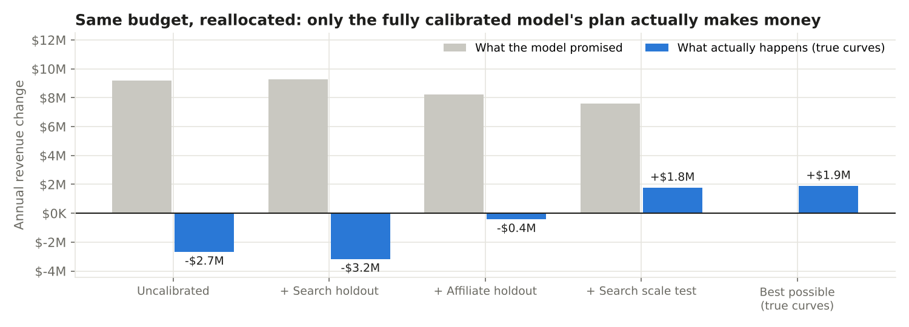
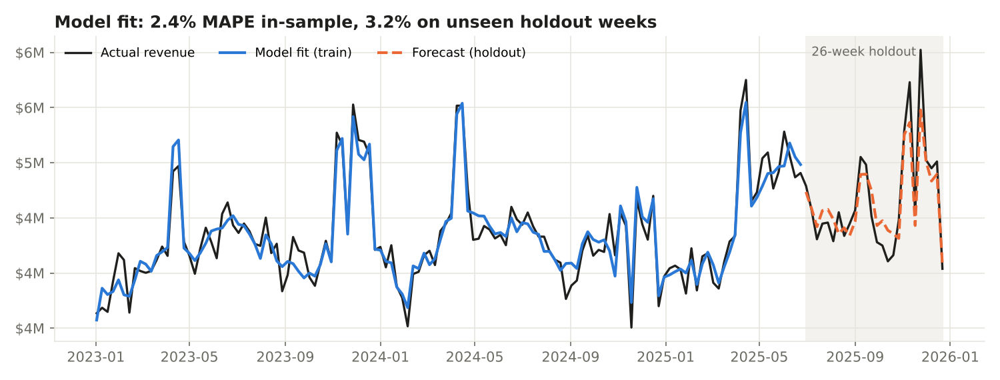
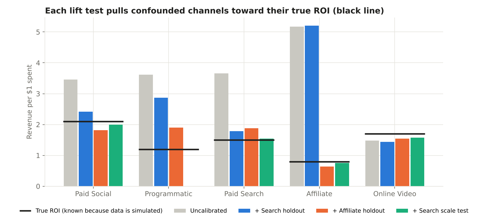
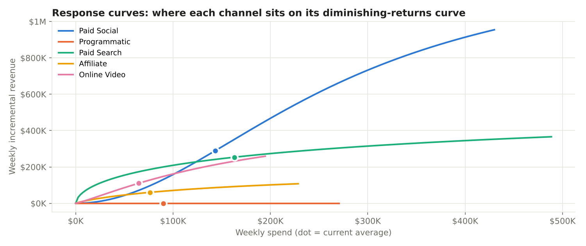
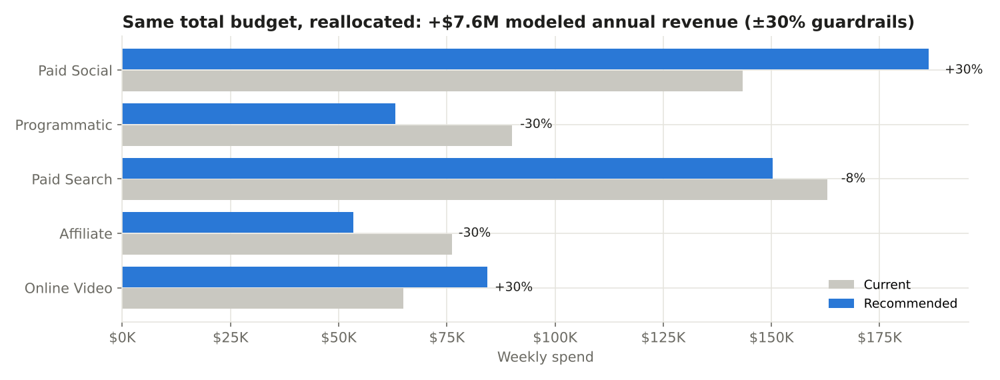

# Marketing Mix Model, calibrated with lift tests

A from-scratch Marketing Mix Model (MMM) in Python for a fictional omnichannel beauty retailer spending ~$28M/year across **Paid Social, Programmatic, Paid Search, Affiliate, and Online Video**.

The point of the project is the question every MMM team actually faces: **when can you trust the model enough to move budget?** The data is simulated with known true channel effects, so every model output can be scored against the truth.

**Headline:** an uncalibrated MMM fit the data well (2-3% error) and still recommended a budget shift that would have *lost* $2.7M/year while promising +$9.2M. Adding three experiments (two holdouts and one spend-scaling test) as calibration produced a plan that truly gains **+$1.8M/year, about 94% of the best achievable** under the same guardrails.



---

## What's in the model

| Piece | What it does | Where |
|---|---|---|
| **Adstock** | Carryover: spend keeps working in later weeks (geometric decay, normalized) | `mmm/transforms.py` |
| **Saturation** | Diminishing returns (Hill curve: half-saturation point + shape) | `mmm/transforms.py` |
| **Base demand** | Trend, Fourier seasonality, and sale events (spring/fall loyalty sales, BFCM, December) | `mmm/model.py` |
| **Fitting** | Global search over nonlinear media params (differential evolution) with an exact bounded least-squares solve for the linear coefficients inside; media effects constrained ≥ 0 | `mmm/model.py` |
| **Regularization** | Light ridge + DECOMP.RSSD (from Meta's Robyn): penalizes splits where a channel's share of credit is wildly off its share of spend | `mmm/model.py` |
| **Calibration** | Experiment results added to the objective: holdouts pin a channel's *average* return, scale tests pin its *marginal* return | `mmm/model.py` |
| **Validation** | Train on 130 weeks, forecast 26 unseen weeks | `scripts/run_mmm.py` |
| **Budget optimizer** | Reallocate a fixed total budget to equalize marginal ROI, with ±30% per-channel guardrails | `mmm/optimize.py` |

## The simulated world (and its trap)

`scripts/simulate_data.py` generates 156 weeks of spend and revenue from known adstock, saturation, and ROI values. It also builds in the most common real-world MMM failure: an **unobserved demand driver** (trends, viral products, competitor stockouts) that lifts revenue *and* search and affiliate spend at the same time. Search spend follows query volume and affiliate is paid on commission, so both rise when demand rises on its own (correlation with the hidden driver: +0.73 and +0.80). A regression can't separate the two, so it over-credits those channels.

## Results

### 1. Fit is good, which is not the same as being right



| | MAPE | R² |
|---|---|---|
| Train (130 wks) | 2.4% | 0.91 |
| Holdout (26 wks) | 3.2% | 0.84 |

Every model version below fits about this well. Goodness of fit does not tell you whether credit is assigned to the right channels.

### 2. Each experiment fixes a different problem



| Channel | Uncalibrated | + Search holdout | + Affiliate holdout | + Search scale test | **True ROI** |
|---|---|---|---|---|---|
| Paid Social | 3.46 | 2.42 | 1.82 | 2.00 | **2.10** |
| Programmatic | 3.61 | 2.87 | 1.90 | 0.00 | **1.20** |
| Paid Search | 3.65 | 1.78 | 1.88 | 1.54 | **1.50** |
| Affiliate | 5.17 | 5.21 | 0.64 | 0.75 | **0.80** |
| Online Video | 1.48 | 1.44 | 1.54 | 1.58 | **1.70** |

What happened at each step:

1. **Uncalibrated:** affiliate is over-credited 6.5x and search 2.4x, as the confounding predicts (and the excess spills into social and programmatic too).
2. **+ Search geo holdout:** search drops to near-true, but the credit it lost **moves to affiliate**, the other confounded channel. Calibrating one channel can push the bias into its neighbor.
3. **+ Affiliate publisher holdout:** affiliate lands near-true. Average ROIs now look reasonable, but the budget plan still loses money (chart at top), because the model believes search has room to grow.
4. **+ Search spend-scaling test** (+40% spend in test markets): a holdout tells you a channel's *average* return. It doesn't tell you the return on the *next* dollar. The scale test pins the shape of the search response curve, and the budget plan flips from losing money to +$1.8M/year.

### 3. Response curves and the recommended plan




The calibrated plan moves budget into Paid Social and Online Video and out of Affiliate and Programmatic, holding the total flat.

### 4. Honest limitations

- **Programmatic was never tested, and the final model zeroes it out** (true ROI 1.2). Credit removed from the tested channels has to land somewhere. This makes programmatic the next experiment on the roadmap, and it's why the optimizer is capped at ±30%.
- **The model's promised uplift (+$7.6M) is ~4x what is real (+$1.8M).** Optimizers exploit model error. Treat recommendations as direction plus a test plan, not a forecast.
- **No uncertainty intervals.** A Bayesian MMM (PyMC-Marketing, Google Meridian) gives posterior ranges and treats lift tests as priors. This project uses a transparent frequentist version so every step is inspectable.
- **Simulated data.** Real data adds tracking gaps, creative effects, pricing, competitor activity, and channel interactions.

## How I'd run this in practice

1. Fit the MMM on 2-3 years of weekly spend and outcomes with known calendar events.
2. Rank channels by **(spend) × (uncertainty in ROI)** and run geo holdouts on the top of that list, starting with channels whose spend follows demand (search, affiliate, retargeting).
3. Before moving material budget into a channel, run a **scale test** at the new spend level.
4. Recalibrate quarterly; reallocate within guardrails; read results against the model's prediction.

## Run it

```bash
pip install -r requirements.txt
python scripts/simulate_data.py   # writes data/
python scripts/run_mmm.py         # ~2 min; writes reports/figures, reports/results.md
pytest -q
```

Full tables, including fitted vs. true adstock decay and per-channel marginal ROI: [`reports/results.md`](reports/results.md).

## Repo layout

```
mmm/
  transforms.py   adstock, saturation
  model.py        MMM fit, calibration, decomposition, ROI / marginal ROI
  optimize.py     budget reallocation
scripts/
  simulate_data.py
  run_mmm.py
data/             simulated weekly data, lift test results, ground truth
reports/          figures and result tables
tests/
```

*All data is simulated. Channel mix and calendar events are modeled on a typical omnichannel beauty retailer; no company data is used.*
